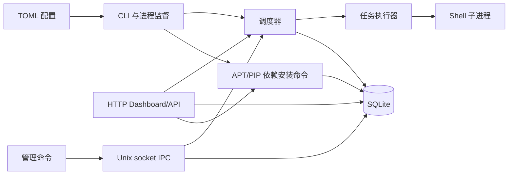

# FlashCron 架构与项目结构

本文说明 FlashCron 的目标部署模型、构建版本和代码边界。项目仅支持 Linux，发布目标为 x86_64 GNU、x86_64 musl 和 aarch64 GNU。除特别标注为“目标设计”的内容外，描述的是当前源码结构；源码已有模块不代表默认镜像已启用对应功能。

## 产品定位

FlashCron 面向容器内的周期任务运行。core 任务定义来自 TOML；启用 Web 后，任务元数据由 SQLite 保存并通过 Dashboard 管理，脚本内容由固定目录中的文件保存，任务由容器内 shell 执行。数据库也持久化执行历史和可选依赖清单；全局运行统计仅保存在当前进程内。

项目规划了三个有意区分的产品版本：

| 产品版本 | 能力 | 对应 Cargo feature 组合 |
|---|---|---|
| 纯守护进程 | 调度、执行、CLI、本地 IPC，不提供 Web 或依赖管理 | `--no-default-features` |
| Web 版本 | 守护进程加 HTTP Dashboard/API、SQLite 任务元数据和执行历史、脚本目录 | 默认 `web` feature |
| 依赖管理版本 | Web 能力加 APT/PIP 依赖管理及启动恢复 | `dep-manager`（自动启用 `web`） |

`Cargo.toml` 默认启用 `web`，`dep-manager` 依赖 `web`，没有专用 profile alias。源码 Dockerfile 默认构建 `dep-manager` 版本。Release workflow 为 x86_64 GNU、x86_64 musl 和 aarch64 GNU 构建 core、web 和依赖管理三种变体；Docker 发布使用 `Dockerfile.ci` 分别构建 Web 与依赖管理多架构镜像，默认无后缀标签指向依赖管理版。

## 架构

进程监督入口在 `src/cmd/daemon.rs`。它加载配置、按 feature 初始化数据库和服务、启动调度器，并处理关闭和配置文件热加载。`src/cmd/cli.rs` 实现配置验证、任务查询和 IPC 命令；`commands.rs` 保留命令入口 facade。调度器通过内部 Tokio channel 接收触发、状态查询、重载和停止消息；外部 CLI 使用 Unix socket 上的 JSON 请求控制运行中的进程。启用 `web` 时，Axum HTTP 服务提供 Dashboard 和 API。

调度器使用 `BinaryHeap` 按下一次触发时间排序，并通过 Tokio 消息通道接收控制和执行完成通知。任务进程由异步 executor 创建；HTTP handler 和 scheduler 之间通过 `SchedulerHandle` 交互，不直接修改调度循环内部状态。

## 项目结构

| 路径 | 职责 |
|---|---|
| `src/main.rs` | CLI 参数解析、日志初始化、命令分派 |
| `src/cmd/args.rs` | 命令和参数定义 |
| `src/cmd/daemon.rs` | 守护进程监督、IPC server、热加载和关闭 |
| `src/cmd/cli.rs` | 配置验证、任务查询及 IPC 客户端命令 |
| `src/cmd/commands.rs` | CLI 与 daemon 实现的 facade |
| `src/cmd/state.rs` | 配置路径解析 |
| `src/cmd/logging.rs` | 日志初始化 |
| `src/config/` | TOML 配置、任务定义、校验、cron 表达式预编译和执行记录类型 |
| `src/scheduler/` | 引擎、状态、消息协议和独立调度器测试 |
| `src/executor.rs` | shell 子进程创建、环境和工作目录设置、输出捕获、超时处理 |
| `src/ipc.rs` | Unix socket 路径、JSON 协议类型和客户端请求 |
| `src/db/` | SQLite schema 与持久化；`packages.rs` 单独管理可选依赖清单 |
| `src/web/` | HTTP 入口与鉴权；jobs、scripts、history、packages handler 按资源拆分 |
| `src/web/index.html` | 内嵌 Dashboard 前端 |
| `src/dep_manager.rs` | APT/PIP 依赖同步、软件源配置和数据库状态更新 |
| `build.rs` | 构建时压缩内嵌 Dashboard HTML |
| `tests/` | CLI、IPC 生命周期、任务执行和集成行为测试 |
| `benches/` | 调度器和 cron 解析基准 |
| `Dockerfile` | 容器内源码构建并打包运行镜像 |
| `Dockerfile.ci` | 从 release workflow 下载的二进制构建运行镜像 |
| `.github/workflows/` | Linux CI 与二进制/容器发布 |

## 横切约定

- 调度热路径复用预编译 cron 表达式和优先队列；避免无依据的全量配置复制或重复解析。
- Tokio worker 上不得执行阻塞式长任务。包安装等外部命令使用异步子进程接口，并将其状态交给服务层查询。
- 运行状态日志使用 `log` crate 的结构化 key-value 字段；不要把凭据放入日志字段或消息正文。
- Web 前端是构建时内嵌并压缩的单一 `src/web/index.html` 文件。前端 API 请求需处理网络错误。
- API token 未配置时会在启动时随机生成并写回 TOML 配置；token 不写入日志。
- 除状态/历史等既有只读接口外，任务定义与脚本内容读取也要求 API token，避免泄露 command、环境变量和脚本源码。
- Web 任务 command 是 token 授权用户提供的 shell 命令；core command 来自部署者管理的 TOML。两者都沿用现有 shell 执行语义。

## 状态和持久化边界

- core 模式下 TOML 是调度任务和全局设置的来源，任务从配置热加载。
- Web 模式下 TOML 提供全局 `[settings]`；出现 `[jobs.*]` 时忽略并记录警告，不导入 TOML jobs。SQLite `jobs` 表是任务元数据唯一来源，保存与删除通过 scheduler 消息串行写库并更新内存；TOML 热重载保留数据库 jobs。
- SQLite 保存 Web 任务元数据与执行历史；全局运行统计在进程重启后归零。`dep-manager` 启用时，SQLite 也保存受管理依赖清单、目标版本和安装状态。
- Web 脚本内容只存于 `settings.script_dir`（默认位于配置文件目录下的 `scripts`）；需将该目录和 SQLite 文件放入持久卷。启动不扫描、比较或重建脚本；脚本文件变化不通知 scheduler，引用不存在文件的任务仍会触发并按 shell 执行失败记录。
- 依赖清单是期望状态；容器文件系统中的实际安装状态是运行时状态。重建容器后必须重新对照依赖清单，不能沿用旧容器的 `Installed` 状态作为当前环境证明。
- 当前实现中，任务从 TOML 移除后，对应历史会被清理。这是项目确认的保留策略，不视为数据丢失缺陷。
- 当前 scheduler 的 `Idle / Queued / Starting / Running` 是任务运行状态，不等同于整个服务或依赖恢复状态。

## 关键架构约束

- 依赖恢复是启动初始化工作；不设置 FlashCron 自身的安装超时。
- HTTP 和 IPC 的监听及依赖状态查询必须先于耗时恢复工作可用；恢复等待不能占住控制面。
- 任务调度必须等待依赖恢复成功；失败后继续暂停，直到人工重试成功，避免任务在依赖尚未准备好时执行。
- 依赖安装输出需要支持进行中查询，并提供未经改写的 stdout/stderr 内容及其合并观察顺序。两个独立管道无法还原跨管道的精确进程写入先后；不能将观察顺序描述为进程级原始写入顺序。
- 普通 Dashboard 在恢复期间及失败后显示恢复状态页。HTTP 允许根路径、健康检查、恢复查询/重试和依赖列表读取，其他 API 返回 503；IPC 仍可查询状态、恢复输出及请求停止。健康检查在恢复成功前返回 503。
- 预期实例运行在容器中。多用户宿主机 IPC 权限隔离不属于当前产品范围。
