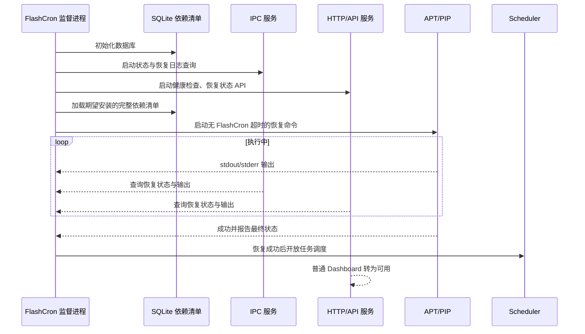

# FlashCron 功能执行流程

本文说明当前源码的主要执行流程；容器发布中的已知限制见“容器构建与三种版本”。

## 启动与守护进程

当前 `flashcron run` 在前台运行；`flashcron run --daemon` 会派生脱离终端的子进程。core 监督进程加载并校验 TOML jobs；Web 监督进程读取 TOML settings，忽略 `[jobs.*]` 并记录警告，再从 SQLite `jobs` 表加载、编译并校验任务。Web 数据库不可用时启动失败，不回退运行 TOML jobs。之后绑定 IPC socket、启动 IPC/HTTP/配置 watcher/信号任务并运行 scheduler。关闭时请求 scheduler 停止，等待正在执行的任务至 `shutdown_timeout`，随后停止辅助服务并删除 socket 文件。

启用 `dep-manager` 时，监督进程先绑定 IPC 并启动 HTTP 服务任务，再在后台恢复完整依赖清单。Scheduler 等待恢复成功后才执行启动任务和定时任务，期间仍处理状态查询、配置重载与停止消息。恢复失败后继续暂停调度，可通过 HTTP 重试；详见“依赖管理与容器恢复”。

## 配置加载与热重载

1. CLI 解析配置路径；`FLASHCRON_CONFIG` 可提供默认路径。
2. core 配置模块读取 TOML jobs，预编译 cron 并校验；Web 模式读取 settings，忽略 TOML jobs 并记录警告，任务从 SQLite 加载并校验。
3. Scheduler 根据启用任务和有效时区计算下一次运行时间并建立触发队列。Web 的任务新增/编辑与删除通过 scheduler 消息串行处理，在 SQLite 提交成功后更新内存和队列；正在执行的任务继续使用已派发定义。
4. 文件 watcher 监视配置文件所在目录，并按目标文件名过滤事件。
5. 配置变更后重新读取和校验；core 重载 TOML jobs，Web 重载全局 settings 并保留 SQLite jobs。成功时更新 executor 默认值、重建触发队列并保留同名任务的进程内运行统计和状态。core 移除已删除任务的等待项，已开始的执行自然结束。新的并发上限立即用于派发：增大上限会推进等待队列，降低上限会等待已有执行释放名额。失败时记录错误，继续使用旧配置。

## 定时与手动触发

1. Scheduler 等待优先队列中的最近触发时间或内部消息。
2. 到期任务重新计算下一次触发时间，并检查任务是否已在队列或运行中。
3. 同一任务在途时跳过重叠触发；接受触发即记录 execution ID 并清空旧输出，按 FIFO 顺序进入 ready queue。
4. 按当前 `max_concurrent_jobs` 派发任务，0 表示无限并发。任务进入 Starting 时预留名额并增加 `running_jobs`，进入 Running 时不重复计数。
5. 手动 `trigger` 由 CLI 发 JSON 请求到 Unix socket，再由 IPC server 调用 `SchedulerHandle`；Scheduler 返回 execution ID，实际执行异步进行。
6. 任务完成后按当前历史设置写 SQLite，释放运行名额并发送完成消息以推进排队任务。异步输出和完成回写核对 execution ID，防止旧执行覆盖重新创建的同名任务；即使任务条目已删除，也会释放该执行占用的名额。

## Shell 任务执行

1. Executor 选择任务 shell 或全局 shell/参数。
2. 设置工作目录；仅当 FlashCron 以 root 运行时切换 Linux UID/GID，`user` 留空默认使用 `nobody`，非 root 运行时忽略 `user` 并沿用服务进程身份；随后设置环境变量。
3. 启动 shell 子进程，stdin 关闭，stdout/stderr 分别捕获。
4. 通过有界 channel 收集两个读取任务的输出。最终捕获内容按 `max_output_size` 限长，实时输出独立保留最近 8 KiB；达到捕获上限或上限为 0 时，实时输出仍持续更新。配置了 timeout 时对等待过程设置任务超时。
5. Scheduler 根据退出码或错误决定成功、失败、超时及重试，并更新状态和数据库。
6. 若任务耗尽重试后最终失败且配置了 `settings.failure_hook`，Scheduler 异步启动该脚本，通过 stdin 发送一行 JSON；Hook 错误仅记录日志。

失败 Hook 消息示例：

```json
{
  "event": "job.failed",
  "job_name": "backup",
  "trigger": "cron",
  "ended_at": "2026-11-21T08:01:12Z",
  "attempt": 3,
  "error": "exit_code",
  "output": "Backup command failed: permission denied"
}
```

`trigger` 为 `cron`、`manual` 或 `startup`；`attempt` 是含首次执行在内的总次数；`error` 为 `exit_code`、`timeout` 或 `execution_error`。超时以及无可用输出时 `output` 为 JSON `null`。

Linux 超时处理向启动时保存的进程组 ID 发送 SIGKILL，再回收直接子进程；即使 shell 已退出，仍会终止留在同一进程组并持有输出管道的后代。自行脱离该进程组的后代不在此清理范围内。APT/PIP 命令不使用任务超时路径。

## IPC 与 HTTP 控制

### IPC

1. 守护进程在固定路径 `/tmp/flashcron.sock` 上监听。
2. 客户端将 `Status`、`PackageRestoreStatus`、`Trigger`、`Stop`、`HistoryList` 或 `HistoryGet` 编码为单行 JSON 并连接 socket；`PackageRestoreStatus` 当前是协议请求，没有独立 CLI 子命令。
3. Server 读取 JSON，调用 scheduler 或数据库，编码单行 JSON 响应。

IPC 是本机进程间的传输通道；请求/响应则构成简单的 RPC 式控制协议。当前 socket 的多用户隔离不在容器产品范围内。请求字节上限和读取超时尚未实现，也不是已确认的产品要求。

### HTTP

启用 `web` 时，Axum 提供 dashboard、健康检查、scheduler 状态、任务列表/新增/编辑/删除、脚本列表/读取/写入/删除、历史和触发 API。删除任务会拒绝仍在运行的任务，并事务删除任务定义和历史；Dashboard 的成功/失败计数从 SQLite 当前保留的执行历史汇总，CLI 与 scheduler 状态中的计数仅覆盖当前进程，重启后归零。任务条目只提供最近一次运行状态。删除脚本只删除 `settings.script_dir` 中对应文件，不扫描任务引用。脚本新建/编辑后权限为 `0755`；选择脚本仅把 shell-quoted 路径填入普通 command。任务定义及脚本内容读取、所有写入操作需要 API token。启用 `dep-manager` 时，Dashboard 提供独立的依赖管理页面，并注册依赖清单查询、添加和删除 API，以及 `GET/POST /api/pkg/restore` 恢复查询和重试接口。添加依赖会先写入 SQLite，再在后台启动同步。

恢复期间及失败后，根路径显示恢复页，`GET /api/pkg` 与恢复接口仍可访问，其他业务 API 返回 503；`/health` 在恢复成功前也返回 503。恢复页每秒查询状态和输出，失败时显示重试表单，允许输入 API token 或使用已保存的 token，并显示查询、鉴权及重试错误。恢复成功后页面自动重新加载普通 Dashboard。

API 中间件当前对非 GET/HEAD 方法校验 `Runtime-Id` 请求头中的 token，读取方法跳过鉴权。未配置 token 时启动代码生成随机 UUID 并写回 TOML 配置；token 不写入日志。前端将 token 保存在浏览器 `localStorage`，请求失败时返回错误状态供界面处理。

`GET /api/settings` 与 `PUT /api/settings` 仅提供 `failure_hook` 路径读写，GET 也要求 `Runtime-Id` token。PUT 经 scheduler 消息串行写回 TOML，成功后更新当前运行设置；传入 `null` 或空白路径会移除配置并关闭 Hook。Dashboard 顶栏齿轮打开标题为“设置”的表单，通过这两个接口读取和保存该字段。

## 数据库与历史清理

1. `DatabaseManager::init` 打开 `settings.sql_file` 并创建历史表；Web 创建 `jobs` 表，启用 `dep-manager` 时创建依赖清单相关表。
2. 每次任务完成时，在同一 SQLite 事务内插入新执行记录，删除当前任务超额的旧记录，再删除全局超额的旧记录。按 `start_time` 从新到旧保留，同一时间用 `rowid` 排序；事务失败时全部回滚。`max_history_size = 0` 不保存历史，`job_history_size = 0` 为该任务保留 0 条。成功/失败统计只更新 scheduler 的进程内状态。
3. API/IPC 查询历史；详情查询可返回持久化输出。
4. 启动和周期维护按每任务上限、全局上限及当前配置任务名清理记录。

删除 Web 任务会同步删除任务定义和执行历史，其他任务历史保留。部署侧仍需持久化 SQLite 文件，才能在容器重建后保留依赖清单和需要保留的历史。

## 依赖管理与容器恢复

### 添加依赖

1. Dashboard 新增弹窗选择 APT/PIP 类型，每行一个依赖名或 `依赖名=版本`；PIP 还支持 `依赖名==版本` 和原有版本约束。HTTP `POST /api/pkg` 接收 `pkg_type` 与 `packages` 数组，每项包含 `name` 和可选 `target`，并先校验整批输入。
2. 数据库在一次事务中插入或更新依赖清单，并将状态置为 `Pending`。
3. 每次新增请求启动一次后台任务，调用 `sync_packages()` 查询数据库中的 Failed/Pending 项，按 APT 与 PIP 分组并发处理，同类型依赖复用批量命令。
4. APT/PIP 执行命令后，将状态写为 Installed 或 Failed，并保存当前版本/错误文本。
5. `GET /api/pkg` 返回数据库中的依赖状态。

Dashboard 支持勾选多行并通过 `DELETE /api/pkg` 提交 ID 数组，事务删除依赖清单记录；单行删除沿用相同逻辑。移除清单不会卸载当前容器内已安装的依赖。

依赖管理页提供软件源读写接口 `GET/PUT /api/pkg/sources`。APT 仅支持 Debian：从 `/etc/apt/sources.list` 和 `/etc/apt/sources.list.d/` 的 `.list` / `.sources` 文件识别路径恰为 `/debian` 或 `/debian-security` 的 URI，匹配时忽略 HTTP/HTTPS 协议差异；界面只显示普通仓库的 scheme 与主机；配置了多个不同镜像时，当前地址留空，仍可填写统一镜像或修改 PIP 配置。替换时分别用输入地址加 `/debian` 和 `/debian-security`。PIP 使用 `pip config --site set global.index-url` 写入配置，使用 `pip config get global.index-url` 回读；页面优先显示回读的非空值，否则依次回退到非空的 `PIP_INDEX_URL` 和 `https://pypi.org/simple`。安装与恢复时，仅将配置回读的非空值通过 `--index-url` 显式传入；未设置或值为空时不传该参数，由 PIP 自行处理环境变量和默认配置；其他回读错误会中止操作并报告失败。源设置保存在系统/虚拟环境配置文件，不存入 SQLite 清单。

APT/PIP 命令分别读取 stdout/stderr。启动恢复会把输出追加到共享恢复状态，支持执行中查询；运行时添加依赖的后台同步没有接入该恢复输出状态。当前 PIP 路径要求虚拟环境变量；源码 `Dockerfile` 与 `Dockerfile.ci` 的依赖管理变体均配置 `/opt/flashcron-venv`；CI 的 Web 变体不安装 Python 环境。

### 启动时恢复容器软件清单

启动顺序如下，恢复命令不设置 FlashCron 执行超时：



当前恢复行为：

- SQLite 包表保存的是持久化期望清单。每次新容器启动时都要校验/恢复完整清单，不能因旧记录状态为 Installed 而跳过。
- IPC 请求 `PackageRestoreStatus` 与 `GET /api/pkg/restore` 返回 `phase`、`output` 和 `error`；包逐项状态通过 `GET /api/pkg` 查询。
- 普通 Dashboard 在恢复期间及失败后不可用，根路径显示恢复状态界面；HTTP 保留恢复相关接口，IPC 控制通道继续可用。
- 调度任务在恢复成功前保持未放行；失败后等待携带 `Runtime-Id` token 的 `POST /api/pkg/restore` 人工重试，该请求在接受后返回 202，当前状态不是 Failed 时返回 409。
- 恢复输出保存在内存中，失败后保留，重试开始或恢复成功时清空，不写入数据库。查询将字节按有损 UTF-8 转为字符串，并按读取观察顺序合并 stdout/stderr。两个独立管道无法给出进程级精确全局写入顺序。
- 不设置依赖恢复超时。HTTP/IPC 应可持续查询状态；停止行为仍遵循 daemon 的关闭流程。

APT 与 PIP 分组并发恢复，同组使用批量安装命令。数据库初始化失败时恢复状态为 Failed；HTTP 重试会尝试重新打开数据库。恢复输出没有按命令分段，也不保留成功后的输出历史。

## 日志、超时与关闭

日志初始化与运行阶段使用相同的配置加载规则：Web 只加载 settings，core 加载完整配置。日志由 `fern` 与 `log` 输出到 stdout，可选择文本或 JSON 格式，并将 `job_name` 字段规范为 `job`。任务输出按行作为结构化日志字段写出；启用历史持久化时，执行结果也写入 SQLite。

任务配置的 `timeout` 限制单次 shell 执行等待时间；`retry_count` 和 `retry_delay` 控制失败后的重试。守护进程收到 SIGTERM、SIGINT、SIGHUP 或 IPC `Stop` 后通知 scheduler 关闭，scheduler 最多等待 `shutdown_timeout` 让在途任务结束。依赖恢复不使用任务的 `timeout` 设置，也不增加 FlashCron 自身的安装超时；它仍需要向 HTTP/IPC 状态查询持续报告进度。

## 容器构建与三种版本

1. 纯守护进程构建应关闭默认 feature，只编译 scheduler、executor、CLI 和 IPC。
2. Web 构建启用 `web`，包含 Dashboard/API 和任务历史数据库。
3. 依赖管理构建启用 `dep-manager`，自动启用 `web`，包含依赖 API、依赖清单 schema 和启动恢复。
4. Release workflow 为 x86_64 GNU、x86_64 musl 和 aarch64 GNU 构建三种 feature 变体。Docker 发布专用 `Dockerfile.ci` 分别使用 web 与 dep-manager 二进制构建多架构镜像；无后缀标签指向 dep-manager，Web 镜像使用 `web-*` 标签。源码 `Dockerfile` 默认构建 dep-manager 版。
5. 启用依赖管理的容器需把 SQLite 路径映射到持久卷；源码镜像通过 `VIRTUAL_ENV` 与 `PATH` 让 FlashCron 和任务共用 `/opt/flashcron-venv`，依赖在容器重建后从 SQLite 清单恢复。CI 依赖管理镜像使用相同的虚拟环境配置，保留默认软件源。
